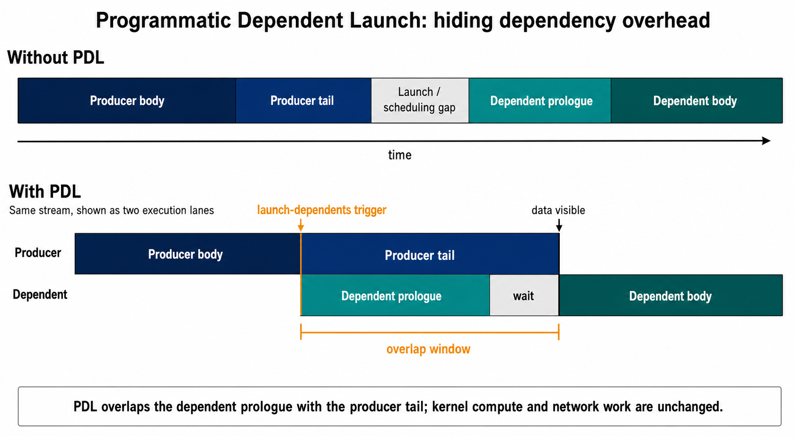
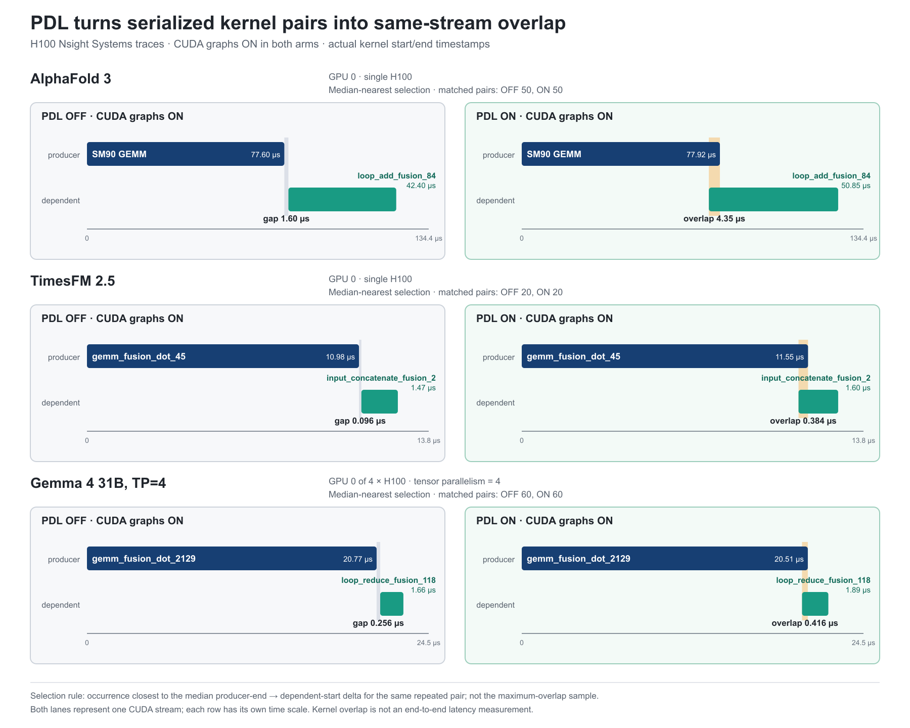

# Using Programmatic Dependent Launch in XLA for JAX Inference

*By Stefano Bosisio, Ilia Sergachev, Fred Oh, and Tejash Shah*

Inference latency is not just the time spent computing. When a model executes
many short GPU kernels, launching and ordering those kernels can become a
meaningful part of each step. XLA provides complementary optimizations for
this overhead: command buffers, implemented using CUDA graphs, and
Programmatic Dependent Launch (PDL).

PDL is a compiler-managed optimization: supported JAX programs can benefit
without rewriting their model or hand-authoring CUDA kernels. Its value
depends on the generated execution schedule, especially how much launch and
dependency-wait time remains after CUDA graphs are enabled.

This post explains the mechanism, shows how to try it in a JAX Toolbox
container, and demonstrates what to look for in a profile. The examples
keep CUDA graphs enabled, so the comparison measures PDL's additional
contribution in a realistic deployment configuration.

## How PDL complements CUDA graphs

[XLA command buffers](https://openxla.org/xla/hlo_to_thunks#command-buffers-optimizing-execution-on-the-gpu)
record GPU work into CUDA graphs for replay, amortizing host-side submission
overhead. PDL addresses a different boundary: the ordering between dependent
kernels on the same CUDA stream.

Normally, a dependent kernel waits for its predecessor to finish. With PDL,
the producer can signal that a dependent kernel may launch while its remaining
work is still executing. The dependent kernel can perform independent setup,
but must synchronize before consuming the producer's output. This can hide
launch latency and overlap a producer's tail with a dependent kernel's
prologue. Overlap is opportunistic, not guaranteed.
[NVIDIA's PDL documentation](https://docs.nvidia.com/cuda/cuda-programming-guide/04-special-topics/programmatic-dependent-launch.html)
describes both stream execution and programmatic dependencies within CUDA graphs.



*Figure 1. PDL separates permission to launch from permission to consume
dependent data. The lower lanes represent two kernels on the same stream,
not two independent streams. This is a schematic, not a measured timeline;
bar lengths and the two panels' endpoints should not be compared as timings.*

PDL does not remove the dependency or make the arithmetic intrinsically
faster. It lets CUDA begin work that is safe to start earlier. Any latency
benefit comes from hiding scheduling and dependency-independent work on
the execution path that determines when the step finishes.

### What XLA does for you

In the XLA implementation examined here, the
[annotation pass](https://github.com/openxla/xla/blob/1ccdb9d3695fd517d7b4a977979db78733c24a3a/xla/backends/gpu/transforms/pdl_launch_annotation.cc)
selects eligible Triton matrix-multiplication kernels followed by a fusion.
[Code generation](https://github.com/openxla/xla/blob/1ccdb9d3695fd517d7b4a977979db78733c24a3a/xla/backends/gpu/codegen/emitters/transforms/insert_pdl_ops.cc)
inserts dependency waits and a launch-dependents trigger after the producer's
final dot operation.
[StreamExecutor](https://github.com/openxla/xla/blob/1ccdb9d3695fd517d7b4a977979db78733c24a3a/xla/stream_executor/cuda/cuda_stream.cc)
uses `cuLaunchKernelEx` with programmatic stream serialization for direct
launches; the
[command-buffer path](https://github.com/openxla/xla/blob/1ccdb9d3695fd517d7b4a977979db78733c24a3a/xla/stream_executor/cuda/cuda_command_buffer.cc)
encodes programmatic graph dependencies. Coverage is selective—not every
kernel or library call automatically gains an early-launch opportunity.

The synchronization protects correctness: starting a kernel early does not
allow it to read unfinished output. XLA also identifies dependent operands
that must not receive unsafe invariant-load assumptions. This is why
extending PDL coverage requires compiler and kernel-safety work, not simply
enabling early launch for every operation.

## Start with a JAX Toolbox container

[JAX Toolbox containers](https://github.com/NVIDIA/JAX-Toolbox#container-images)
provide a prebuilt JAX/XLA GPU software stack. Here is an example of the images we are producing:

| Application | Nightly image | What you still supply |
|---|---|---|
| General JAX/Flax inference, ideal for testing TimesFM workloads | `ghcr.io/nvidia/jax:jax` | Model-specific dependencies, code, and inputs |
| MaxText | `ghcr.io/nvidia/jax:maxtext` | Model configuration, inputs, and any required weights |
| AlphaFold 3 | `ghcr.io/nvidia/jax:alphafold` | Inputs, databases, and authorized model parameters |

*Table 1. Image families documented by JAX Toolbox. These are moving nightly
tags; using the same tag on different days does not guarantee the same build.*

Run them on a Linux NVIDIA GPU machine, with a compatible driver, Docker,
and the [NVIDIA Container Toolkit](https://docs.nvidia.com/datacenter/cloud-native/container-toolkit/latest/install-guide.html)
configured. PDL requires a supported XLA build and a Hopper-or-newer GPU.
For the accompanying scripts, first change to `blog/xla-pdl` in your
JAX Toolbox checkout on the host, then run:

```bash
PDL_IMAGE=ghcr.io/nvidia/jax:jax
docker pull "$PDL_IMAGE"

docker run --rm -it --gpus 'device=0' --shm-size=2g \
  --env "PDL_IMAGE_PINNED=$PDL_IMAGE_PINNED" \
  --mount "type=bind,source=$PWD,target=/workspace" \
  --workdir /workspace "$PDL_IMAGE_PINNED" bash
```

The mounted directory keeps scripts and results on the host. Inside the
container, verify that JAX sees the GPU:

```bash
python -c 'import jax, jaxlib; print("JAX:", jax.__version__, "jaxlib:", jaxlib.__version__); print(jax.devices()); assert jax.default_backend() == "gpu"'
```

For a multi-GPU application, expose the intended devices instead; `--gpus all`
exposes all available GPUs. It does not configure tensor parallelism—the
application's device mesh and model settings must do that. Keep the device
selection and mesh identical across the comparison.

## Enable PDL without changing your JAX model

PDL is already enabled in your build. Specifically we can interact with PDL with the following flags:

```bash
# Inside the container. Inspect this before adding the experiment's flags.
PDL_COMMON_FLAGS="${XLA_FLAGS:-}"
printf 'Common XLA flags: %s\n' "$PDL_COMMON_FLAGS"

PDL_OFF_FLAGS="--xla_gpu_enable_pdl=false --xla_gpu_enable_pdl_launch=false"
PDL_ON_FLAGS="--xla_gpu_enable_pdl=true --xla_gpu_enable_pdl_launch=true"

XLA_FLAGS="$PDL_COMMON_FLAGS $PDL_OFF_FLAGS" python inference.py
XLA_FLAGS="$PDL_COMMON_FLAGS $PDL_ON_FLAGS" python inference.py
```

Replace `inference.py` with your existing inference entry point
TODO: fix this
Before running, remove any conflicting PDL overrides from `PDL_COMMON_FLAGS` and
ensure it does not contain the empty `--xla_gpu_enable_command_buffer=`
override, which disables command buffers. Keep all other flags unchanged.

Of the [two XLA flags](https://github.com/openxla/xla/blob/1ccdb9d3695fd517d7b4a977979db78733c24a3a/xla/debug_options_flags.cc),
`--xla_gpu_enable_pdl` is the master switch;
`--xla_gpu_enable_pdl_launch` controls launch-instruction emission within
the enabled path. For explaining PDL in the following sections we will refer only to the master switch.


### Run the accompanying workload scripts

The [benchmark and profiling bundle](benchmark_scripts/README.md) contains
all the scripts for the three workloads in this post. Each model has
separate entry points for unprofiled latency, XProf, and Nsight Systems:

| Workload | Latency | XProf | Nsight Systems |
|---|---|---|---|
| Gemma / MaxText | [Benchmark](benchmark_scripts/gemma/run_benchmark.sh) | [XProf](benchmark_scripts/gemma/run_xprof.sh) | [Nsight](benchmark_scripts/gemma/run_nsys.sh) |
| TimesFM / Flax | [Benchmark](benchmark_scripts/timesfm/run_benchmark.sh) | [XProf](benchmark_scripts/timesfm/run_xprof.sh) | [Nsight](benchmark_scripts/timesfm/run_nsys.sh) |
| AlphaFold 3 | [Benchmark](benchmark_scripts/alphafold/run_benchmark.sh) | [XProf](benchmark_scripts/alphafold/run_xprof.sh) | [Nsight](benchmark_scripts/alphafold/run_nsys.sh) |

*Table 2. Entry points in the accompanying script bundle, reconstructed from
the original experiment drivers. Model dependencies, inputs, and parameters
must be supplied in the appropriate container.*

For example, from the mounted `xla-pdl` directory (`/workspace` with the Docker
command above), inside a container with TimesFM's Flax dependencies installed:

```bash
export CUDA_VISIBLE_DEVICES=0 BATCH_SIZE=1 CONTEXT_LEN=512 HORIZON_LEN=512

# Inspect both commands without starting JAX or creating output files.
bash benchmark_scripts/timesfm/run_benchmark.sh --dry-run

# Three independent off/on process pairs; alternate their order.
bash benchmark_scripts/timesfm/run_benchmark.sh \
  --repeats 3 --out-dir results/timesfm_latency

# Separate captures, never used as the benchmark timing source.
bash benchmark_scripts/timesfm/run_xprof.sh --out-dir results/timesfm_xprof
bash benchmark_scripts/timesfm/run_nsys.sh --nsys-tool nsys-jax \
  --out-dir results/timesfm_nsys
```

Each entry point runs **both PDL arms with graphs enabled**, writes a manifest
and per-arm logs, and refuses to overwrite an existing experiment directory.
The launcher preserves common XLA settings while replacing the PDL switches;
it rejects an inherited flag that disables command buffers. The
[README](benchmark_scripts/README.md) supplies Gemma TP=1/TP=4 examples,
AF3 input preparation, shape overrides, and instructions for opening/exporting
the captures. The [provenance notes](benchmark_scripts/PROVENANCE.md) identify
the original sources and deliberate corrections. These are reusable runners,
not a claim that today's container reproduces a historical performance number.

## Measure PDL's marginal effect

The comparison is **PDL off versus PDL on with CUDA graphs enabled**.
Comparing both optimizations off with both on measures their combined
effect, not PDL's additional contribution.

JAX dispatch is asynchronous. Timing the Python call without waiting can
measure submission rather than completed inference. Place inputs on the
device first, warm up the workload, and wait for the result inside each
timed iteration. For example, adapt this helper to your inference runner:

```python
import statistics
import time
import jax

def measure_step(step, *, warmup=5, iterations=20):
    for _ in range(warmup):
        jax.block_until_ready(step())

    samples_ms = []
    for _ in range(iterations):
        start = time.perf_counter()
        jax.block_until_ready(step())
        samples_ms.append((time.perf_counter() - start) * 1_000)

    print("mean_ms:", statistics.mean(samples_ms))
    print("median_ms:", statistics.median(samples_ms))
    return samples_ms
```

Here, `step` is a callable that executes one real inference unit and returns
its JAX outputs. For decoding, advance the cache/state as usual and use the
same input/state sequence in both arms. The warmup count is illustrative:
ensure compilation, autotuning, and graph capture have finished before
timing. See the [JAX benchmarking guide](https://docs.jax.dev/en/latest/benchmarking.html).

The supplied TimesFM and AF3 drivers use per-iteration synchronization and
retain the individual samples. Gemma deliberately preserves the native
MaxText microbenchmark: it synchronizes at the end of a measured decode loop
and reports a loop-average step time. That is not the same as an individually
synchronized request-latency distribution; the comparator does not invent
Gemma per-step samples or medians. AF3's legacy `WARM_RUNS=15` setting means
15 measured compile-free iterations, after a separate discarded execution.

Calculate the fractional latency reduction as
`(T_off - T_on) / T_off`, using the same summary statistic for both arms.
Save individual samples, repeat independent process pairs, and alternate
their order. Keep shapes, precision, batch size, clocks, and device mesh
fixed, and run without unrelated GPU activity.

The bundle saves its marginal-PDL summary automatically. To inspect it again:

```bash
python benchmark_scripts/compare_results.py results/timesfm_latency/manifest.json
```

The comparator rejects profiling experiments and displays paired results as
well as the aggregate, without claiming that a small positive delta is
statistically significant.

Also hold autotuning choices fixed. Reuse
[persisted autotuning results](https://openxla.org/xla/persisted_autotuning)
for the same GPU type and software build, then verify matching kernel
choices across arms. A cache can miss, so merely sharing a directory is
not proof that two runs selected identical algorithms. This matters when
the expected saving is small. Check output correctness as well as timing.

## See the effect in a profile

Collect profiles in separate runs: CUDA-graph node tracing can perturb
the scheduling overhead you are trying to measure. Use unprofiled runs
for latency and profiles for the explanation.

JAX Toolbox's nightly containers include
[`nsys-jax`](https://github.com/NVIDIA/JAX-Toolbox/blob/main/docs/nsys-jax.md),
which wraps Nsight Systems and bundles JAX/XLA metadata with the trace.
Using the same shell variables as above:

```bash
mkdir -p profiles

XLA_FLAGS="$PDL_COMMON_FLAGS $PDL_OFF_FLAGS" \
  nsys-jax --trace=cuda,nvtx --cuda-graph-trace=node \
  --sample=none --cpuctxsw=none --python-sampling=false \
  -o profiles/pdl_off -- python inference.py

XLA_FLAGS="$PDL_COMMON_FLAGS $PDL_ON_FLAGS" \
  nsys-jax --trace=cuda,nvtx --cuda-graph-trace=node \
  --sample=none --cpuctxsw=none --python-sampling=false \
  -o profiles/pdl_on -- python inference.py
```

Use a short profiling run that includes warmup and a few steady-state
iterations. These commands capture the whole process; for long-running
models, use [Nsight's capture-range controls](https://docs.nvidia.com/nsight-systems/UserGuide/index.html#focused-profiling)
to limit collection. Do not overwrite `XLA_FLAGS` inside the launched
application: `nsys-jax` adds metadata-dump settings to it.

The resulting `profiles/pdl_off.zip` and `profiles/pdl_on.zip` archives
contain `.nsys-rep` files and supporting metadata. Copy and extract them
locally, then open the reports with a compatible Nsight Systems version.
The archives also support the notebook-based analysis described in the
`nsys-jax` documentation. For XProf, collect a separate JAX profiler trace
and mark steady iterations with `jax.profiler.StepTraceAnnotation`.

### What to look for

Select a complete steady-state iteration after compilation and graph
instantiation. Do not assume a host launch range ends when GPU execution
does. Compare corresponding kernel pairs on the same GPU, CUDA context,
and stream; inspect CUDA Graph ID and Graph Node ID to distinguish graph
execution from direct launches.

For a producer/dependent pair, calculate:

```text
pair delta = dependent start - producer end
```

A positive delta is a gap; a negative delta is overlap. Check repeated
occurrences, rather than selecting the largest overlap in the trace.



*Figure 2. Re-rendered from the original H100 Nsight Systems timestamps,
with CUDA graphs enabled in both arms. Each panel uses the occurrence
nearest its arm's median pair delta. The two panels in each row share a
scale; different rows do not. Gemma uses TP=4 on four H100s. These are
kernel-scheduling examples, not GB300 results or end-to-end speedup
measurements.*

The figure shows the intended structural change: a dependent kernel begins
before its predecessor ends. It also shows why overlap alone is insufficient:
recorded kernel durations can change, and an overlapping pair need not finish
earlier. Measure the pair's full span and, ultimately, unprofiled step latency.

Corroborate the timeline with `xla.pdl_launch` annotations in compiled HLO.
For direct launches, inspect the programmatic-stream-serialization attribute
when the capture exposes it. A `cuLaunchKernelEx` call alone is not proof
of PDL—it also supports other launch features. During graph replay, do not
expect a separate host launch API call for every kernel node.

Likewise, a lower internal GPU-gap percentage is not a speedup measurement.
It describes blank time between merged GPU activities, while PDL can also
overlap intervals that were already active. Neither gap reduction nor the
sum of local overlaps automatically equals time removed from the step.

## What the workloads taught us

We evaluated AlphaFold 3, TimesFM 2.5, and Gemma 4 on Hopper H100 and Blackwell
GB300 systems. In the tested single-GB300 configurations, additional latency
reductions with CUDA graphs already enabled ranged from negligible to
approximately **4.5%**, with TimesFM's autoregressive forecast (batch 1,
context 512, horizon 512) showing the clearest gain. Separate Gemma tests
with tensor parallelism across four GB300 GPUs showed only small,
inconsistent changes despite observable PDL overlap.

The profile evidence gives three useful lessons:

- **AlphaFold 3:** Long-running kernels dominate the tested 2048-token
  inference. PDL engages, but saving time at launch boundaries changes
  little of the overall step.
- **TimesFM:** Its autoregressive forecast repeatedly schedules short
  kernels, so small savings at eligible boundaries can accumulate into
  a measurable latency reduction. In this runner, horizons beyond 128
  exercise the autoregressive loop; a shorter forecast need not expose
  the same scheduling pattern.
- **Gemma:** Short kernels create opportunities, but generated kernel
  choices, graph segmentation, and collective waiting determine whether
  overlap advances the critical path. More tensor-parallel GPUs do not
  automatically increase PDL's benefit.

The four-GB300 profiles also contained small program-structure differences,
likely from autotuning, so they do not isolate PDL perfectly. Differences
between the H100 and GB300 runs cannot be attributed to GPU architecture
alone. Low-batch inference is a promising starting point, not a guarantee:
evaluate the batch sizes and latency requirements your application actually uses.

## Takeaway

PDL already benefits eligible latency-bound programs without model-specific
tuning. Start with your real inference workload and measure: CUDA graphs
reduce submission overhead, while PDL can recover additional time at eligible
kernel boundaries. Use a pinned JAX Toolbox image, keep command buffers on,
compare explicit PDL settings, and let unprofiled timings establish the gain.
Profiles then answer the separate question: where did the schedule change?
