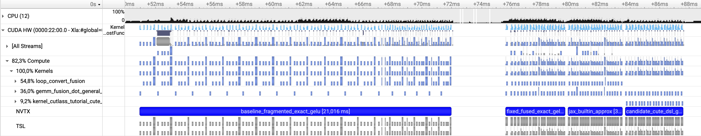
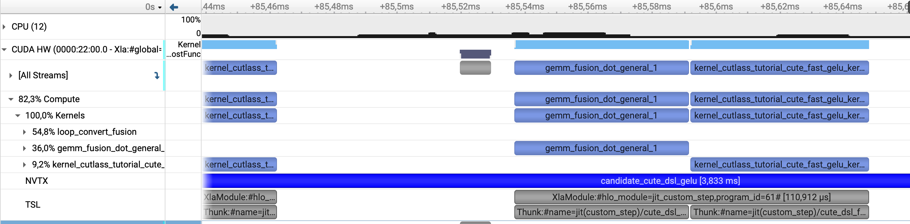
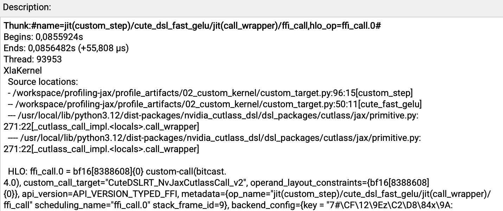
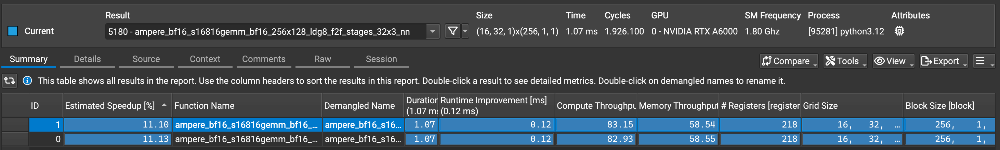
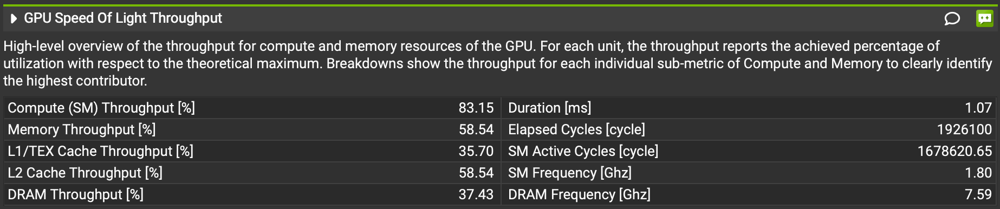
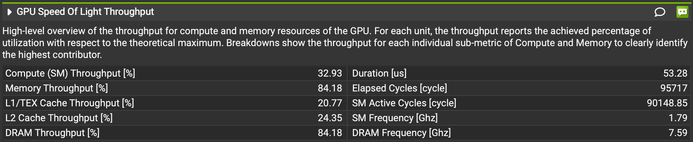

{/* Generated by npm run docs:export. Edit the notebook, then regenerate. */}

[Open the notebook on GitHub](https://github.com/NVIDIA/JAX-Toolbox/blob/main/tutorials/jax-profiling/diagnose_compute_and_memory_bound_custom_jax_kernels.ipynb) · [Helper scripts](https://github.com/NVIDIA/JAX-Toolbox/tree/main/tutorials/jax-profiling/scripts) · [Setup instructions](README.md)

# Diagnose Compute- and Memory-Bound Custom JAX Kernels

**Goal:** find a common `jit`-boundary mistake, fix it without changing the exact GELU, then diagnose and compare a named [CuTe DSL](https://docs.nvidia.com/cutlass/latest/media/docs/pythonDSL/cute_dsl_general/dsl_introduction.html) kernel.

**Profiling skills covered:**

- Correlating HLO metadata with GPU kernels.
- Locating custom kernels with NVIDIA Nsight Systems.
- Diagnosing compute and memory bottlenecks with NVIDIA Nsight Compute.
- Comparing implementations with NVIDIA Nsight Python.

A custom kernel is worth considering after the ordinary JAX program has a sound compilation boundary. We first repair that boundary, then use profiler evidence to decide whether the CuTe implementation earns its extra complexity.

The same projection equation is used throughout:

$$y = \operatorname{gelu}(a @ b + bias)$$

A tall output makes activation traffic visible. The novice mistake is applying `jax.jit` to every small helper while leaving the complete step outside `jit`. Each helper is compiled, but XLA cannot fuse across the Python call boundaries. Intermediate arrays escape to device memory and several kernels are launched.

| Question | Tool |
|---|---|
| Did small `jit` boundaries prevent fusion? | synchronized timing and Nsight Systems |
| What limits one kernel? | Nsight Compute |
| Where did the custom call run? | Nsight Systems and HLO metadata |
| Does the result hold across shapes? | Nsight Python |
| Did the complete step improve? | synchronized JAX benchmark |

## Setup

The [NVIDIA NGC JAX container](https://catalog.ngc.nvidia.com/orgs/nvidia/-/containers/jax) is recommended; another environment meeting the requirements below also works.

Use an NVIDIA GPU with compute capability 8.0 or newer (Ampere or later), CUDA 12.9 or newer, and JAX 0.8.1 or newer for the [CuTe DSL integration](https://docs.jax.dev/en/latest/401/cute-dsl.html). The `nsys` and `ncu` executables must be on `PATH`.

```bash
python -m pip install "nsight-python>=1.0" "nvidia-cutlass-dsl>=4.4" nvtx
```

The direct notebook workflow requires Nsight Python 1.0 or later and Nsight Compute 2026.2.1 or later. Nsight Compute and Nsight Python need GPU performance-counter access. Start the container with `--cap-add=SYS_ADMIN`. If the driver reports `ERR_NVGPUCTRPERM`, enable profiling counters on the host.

Start in a fresh kernel and load JAX and the shared helpers below.

```python
import os

# Set allocator behavior before importing JAX.
os.environ["XLA_PYTHON_CLIENT_PREALLOCATE"] = "false"

import pathlib
import signal
import shutil
import statistics
import subprocess
import time

import jax
import jax.numpy as jnp

ARTIFACTS = pathlib.Path("profile_artifacts/custom_kernel")
ARTIFACTS.mkdir(parents=True, exist_ok=True)


def have(tool):
    return shutil.which(tool) is not None


def run(cmd, timeout=600):
    """Return (exit code, stdout + stderr) without raising on profiler errors."""
    p = subprocess.Popen(
        cmd,
        shell=isinstance(cmd, str),
        stdout=subprocess.PIPE,
        stderr=subprocess.PIPE,
        text=True,
        start_new_session=True,
    )
    try:
        stdout, stderr = p.communicate(timeout=timeout)
    except subprocess.TimeoutExpired:
        try:
            os.killpg(p.pid, signal.SIGTERM)
        except ProcessLookupError:
            pass
        try:
            stdout, stderr = p.communicate(timeout=10)
        except subprocess.TimeoutExpired:
            try:
                os.killpg(p.pid, signal.SIGKILL)
            except ProcessLookupError:
                pass
            stdout, stderr = p.communicate()
        return 124, f"timed out after {timeout}s\n{stdout or ''}{stderr or ''}"
    return p.returncode, (stdout or "") + (stderr or "")


def benchmark_completed(fn, *args, warmup=3, steps=30):
    for _ in range(warmup):
        jax.tree.map(lambda leaf: leaf.block_until_ready(), fn(*args))
    samples = []
    for _ in range(steps):
        start = time.perf_counter()
        jax.tree.map(lambda leaf: leaf.block_until_ready(), fn(*args))
        samples.append((time.perf_counter() - start) * 1e3)
    return {
        "median_ms": statistics.median(samples),
        "min_ms": min(samples),
        "p90_ms": sorted(samples)[int(0.9 * (len(samples) - 1))],
    }


print("JAX:", jax.__version__)
print("backend:", jax.default_backend())
print("devices:", len(jax.devices()), [d.device_kind for d in jax.devices()])
print("tools:", {name: have(name) for name in ('nsys', 'ncu')})
```

## Slow baseline: `jit` every helper

Assume a model author splits a projection and exact GELU into reusable helpers and places `jit` on every helper, expecting compilation to optimize the complete step. Python still calls each compiled helper separately. Intermediates cross compilation boundaries, and the correct result arrives through several launches.

The first fix places the unchanged exact formula inside one top-level `jit`. Once that boundary is sound, the built-in approximation and a custom kernel become separate candidates with a different numerical contract.

CuTe DSL lets us write the CUDA kernel in Python, and `cutlass.jax.cutlass_call` embeds the compiled kernel as an XLA custom call.

The kernel bounds-checks the final block, so it also works when the flattened size is not divisible by 256.

The cell below writes the fragmented exact-GELU path, its whole-step fix, the built-in approximation, and the CuTe DSL implementation to a shared Python file for future reuse. The benchmark cell loads the saved implementations.

```python
%%writefile profile_artifacts/custom_kernel/implementations.py

import jax
import jax.numpy as jnp

import cuda.bindings.driver as cuda
import cutlass
import cutlass.cute as cute
import cutlass.jax as cjax

BLOCK = 256
COMPARISON_SHAPES = ((32768, 256, 256), (65536, 256, 256))


@cute.kernel
def tutorial_cute_fast_gelu_kernel(
    x: cute.Tensor, out: cute.Tensor, n: int
):
    thread, _, _ = cute.arch.thread_idx()
    block, _, _ = cute.arch.block_idx()
    block_size, _, _ = cute.arch.block_dim()
    index = block * block_size + thread
    if index < n:
        value = cutlass.Float32(x[index])
        half = cutlass.Float32(0.5)
        one = cutlass.Float32(1.0)
        coefficient = cutlass.Float32(0.7978845608028654)
        cubic = cutlass.Float32(0.044715)
        y = half * value * (
            one + cute.tanh(
                coefficient * (value + cubic * value * value * value)
            )
        )
        out[index] = y.to(out.element_type)


@cute.jit
def launch_cute_fast_gelu(
    stream: cuda.CUstream,
    x: cute.Tensor,
    out: cute.Tensor,
    *,
    n: int,
):
    tutorial_cute_fast_gelu_kernel(x, out, n).launch(
        grid=((n + BLOCK - 1) // BLOCK, 1, 1),
        block=(BLOCK, 1, 1),
        stream=stream,
    )


def cute_fast_gelu(x):
    flat = x.reshape(-1)
    call = cjax.cutlass_call(
        launch_cute_fast_gelu,
        output_shape_dtype=jax.ShapeDtypeStruct(flat.shape, flat.dtype),
        use_static_tensors=True,
        n=flat.size,
    )
    return call(flat).reshape(x.shape)


@jax.jit
def projection_call(a, b, bias):
    with jax.named_scope("projection"):
        return a @ b + bias


@jax.jit
def scale_for_erf(x):
    with jax.named_scope("exact_gelu_scale"):
        return x * jnp.asarray(0.7071067811865476, x.dtype)


@jax.jit
def apply_erf(x):
    with jax.named_scope("exact_gelu_erf"):
        return jax.lax.erf(x)


@jax.jit
def add_one(x):
    with jax.named_scope("exact_gelu_add"):
        return x + jnp.asarray(1.0, x.dtype)


@jax.jit
def finish_exact_gelu(x, transformed):
    with jax.named_scope("exact_gelu_finish"):
        return 0.5 * x * transformed


def exact_step(a, b, bias):
    h = projection_call(a, b, bias)
    transformed = scale_for_erf(h)
    transformed = apply_erf(transformed)
    transformed = add_one(transformed)
    return finish_exact_gelu(h, transformed)


@jax.jit
def fused_exact_step(a, b, bias):
    with jax.named_scope("fused_exact_gelu"):
        h = a @ b + bias
        transformed = h * jnp.asarray(0.7071067811865476, h.dtype)
        transformed = jax.lax.erf(transformed)
        transformed = transformed + jnp.asarray(1.0, h.dtype)
        return 0.5 * h * transformed


@jax.jit
def builtin_approx_step(a, b, bias):
    h = a @ b + bias
    return jax.nn.gelu(h, approximate=True)


@jax.jit
def custom_step(a, b, bias):
    with jax.named_scope("cute_dsl_fast_gelu"):
        return cute_fast_gelu(a @ b + bias)
```

Benchmark all four implementations on the same BF16 inputs at both shapes in `COMPARISON_SHAPES`. These synchronized timings measure the complete projection/GELU step, including dispatch and synchronization. The CSV preserves the per-shape results for later comparison.

```python
%run profile_artifacts/custom_kernel/implementations.py

import csv

implementations = (
    ("fragmented_exact", exact_step),
    ("fused_exact", fused_exact_step),
    ("jax_builtin_approx", builtin_approx_step),
    ("cute_dsl_custom", custom_step),
)
application_timings = []

for M, K, N in COMPARISON_SHAPES:
    scale = 1 / (K ** 0.5)
    inputs = (
        jnp.full((M, K), scale, jnp.bfloat16),
        jnp.full((K, N), scale, jnp.bfloat16),
        jnp.zeros((N,), jnp.bfloat16),
    )
    if (M, K, N) == COMPARISON_SHAPES[0]:
        first_shape_inputs = inputs

    print(f"\nShape: M={M}, K={K}, N={N}")
    for name, fn in implementations:
        stats = benchmark_completed(fn, *inputs, steps=30)
        application_timings.append({
            "M": M, "K": K, "N": N, "Implementation": name, **stats,
        })
        print(f"{name:20s} {stats}")

application_csv = ARTIFACTS / "application_timings.csv"
with application_csv.open("w", newline="") as output:
    writer = csv.DictWriter(output, fieldnames=list(application_timings[0]))
    writer.writeheader()
    writer.writerows(application_timings)
print("Application timings:", application_csv)

# Keep the first shape available for the HLO and timeline walkthroughs.
M, K, N = COMPARISON_SHAPES[0]
a, b, bias = first_shape_inputs
```

### Check numerical accuracy

Timing inputs are constant, so check accuracy separately on positive, negative, and near-zero activation values. The 513-element activation input and the 771-element projection output also exercise a partial final CUDA block.

For these demonstration inputs, use the explicit policy `|actual - reference| <= 0.004 + 0.008 * |reference|`. This is a chosen absolute and relative tolerance, not a universal BF16 error bound. Compare both approximations with an FP32 exact-GELU reference, and check the complete implementations on a small projection with varied bias. Adopting the approximation in an application also requires representative inputs and an accuracy policy suited to that workload.

```python
import numpy as np

# Demo policy: |actual - reference| <= atol + rtol * |reference|.
# These are chosen tolerances for this check, not a universal BF16 error bound.
VALIDATION_ATOL = 4e-3
VALIDATION_RTOL = 8e-3


def check_gelu(label, actual, reference):
    actual = np.asarray(actual, dtype=np.float32)
    reference = np.asarray(reference, dtype=np.float32)
    assert np.isfinite(actual).all() and np.isfinite(reference).all(), label
    np.testing.assert_allclose(
        actual, reference, atol=VALIDATION_ATOL, rtol=VALIDATION_RTOL,
        err_msg=label,
    )
    print(f"{label}: max absolute error {np.max(np.abs(actual - reference)):.6g}")


# 513 values exercise both signs, values close to zero, and a partial final block.
validation_x = jnp.concatenate([
    jnp.linspace(-6, 6, 509),
    jnp.array([-0.001, 0.0, 0.001, 0.01]),
]).astype(jnp.bfloat16)
x32 = validation_x.astype(jnp.float32)
exact_reference = 0.5 * x32 * (1 + jax.lax.erf(x32 / jnp.sqrt(2.0)))
custom_validation = cute_fast_gelu(validation_x)
builtin_validation = jax.nn.gelu(validation_x, approximate=True)

check_gelu("CuTe vs built-in approximation", custom_validation, builtin_validation)
check_gelu("CuTe vs FP32 exact GELU", custom_validation, exact_reference)
check_gelu("Built-in vs FP32 exact GELU", builtin_validation, exact_reference)

# Separate small step inputs preserve the benchmark inputs used by later captures.
validation_a = jnp.full((3, 256), 1 / 16, jnp.bfloat16)
validation_b = jnp.full((256, 257), 1 / 16, jnp.bfloat16)
validation_bias = (jnp.linspace(-6, 6, 257) - 1).astype(jnp.bfloat16)
validation_args = (validation_a, validation_b, validation_bias)

check_gelu(
    "Fused exact vs fragmented exact",
    fused_exact_step(*validation_args), exact_step(*validation_args),
)
check_gelu(
    "CuTe step vs built-in step",
    custom_step(*validation_args), builtin_approx_step(*validation_args),
)
```

Confirm that the custom code survives lowering before searching for it in a GPU trace. Inspect the compiled CuTe path for its custom-call target and JAX operation name. The printed names should form the compiler-side link between `custom_step` and the generated CUDA kernel.

```python
import re

hlo_text = custom_step.lower(a, b, bias).compile().as_text()
custom_call_targets = sorted(set(
    re.findall(r'custom_call_target="(CuteDSL[^"]+)"', hlo_text)
))
operation_names = sorted(set(
    name
    for name in re.findall(r'op_name="([^"]+)"', hlo_text)
    if "cute_dsl_fast_gelu" in name and "ffi_call" in name
))
print("custom-call targets:", custom_call_targets)
print("operation names:")
print("\n".join(operation_names))
```

The output should give you two names to follow:

- `CuteDSLRT_NvJaxCutlassCall_v2` is the XLA custom-call target. It tells XLA to invoke code produced through the CuTe/CUTLASS runtime.
- `jit(custom_step)/cute_dsl_fast_gelu/.../ffi_call` leads back to the JAX function and its named scope.

Together, these names confirm that `custom_step` reaches the CuTe DSL path. The custom-call target names the runtime bridge; Nsight Systems should show the CUDA kernel symbol that runs on the GPU.

The benchmark compares four choices:

| Implementation | What it tells us |
|---|---|
| `exact_step` | Baseline with the exact formula split across several jitted calls |
| `fused_exact_step` | Direct fix: compile the same exact formula as one function |
| `builtin_approx_step` | Simplest option when the built-in approximation is acceptable |
| `custom_step` | CuTe DSL candidate to keep only if it helps on representative shapes or adds needed behavior |

`fused_exact_step` keeps the erf-based formula, but fusion can change where BF16 values are rounded. Compare it using the stated numerical tolerance rather than requiring bitwise equality. Judge the two approximate paths against the accuracy your workload allows.

## Locate the custom kernel on a GPU timeline with Nsight Systems

The custom-call entry in HLO confirms that the kernel was compiled. Nsight Systems should show where it launches and what surrounds it on the GPU. The target uses NVTX ranges for each implementation, making their GPU activity easier to locate on the timeline.

Write a standalone target containing named ranges for the fragmented exact, fused exact, built-in approximate, and CuTe paths. The built-in approximation is the direct performance baseline for the custom kernel because both use the same GELU approximation.

```python
CUSTOM_TARGET = r"""
import os
os.environ["XLA_PYTHON_CLIENT_PREALLOCATE"] = "false"
import ctypes
import cuda.bindings.driver as cuda
import cutlass
import cutlass.cute as cute
import cutlass.jax as cjax
import jax
import jax.numpy as jnp
import nvtx

BLOCK = 256

@cute.kernel
def tutorial_cute_fast_gelu_kernel(x: cute.Tensor, out: cute.Tensor, n: int):
    thread, _, _ = cute.arch.thread_idx()
    block, _, _ = cute.arch.block_idx()
    block_size, _, _ = cute.arch.block_dim()
    index = block * block_size + thread
    if index < n:
        value = cutlass.Float32(x[index])
        half = cutlass.Float32(0.5)
        one = cutlass.Float32(1.0)
        coefficient = cutlass.Float32(0.7978845608028654)
        cubic = cutlass.Float32(0.044715)
        y = half * value * (
            one + cute.tanh(coefficient * (value + cubic * value * value * value))
        )
        out[index] = y.to(out.element_type)

@cute.jit
def launch_cute_fast_gelu(
    stream: cuda.CUstream, x: cute.Tensor, out: cute.Tensor, *, n: int
):
    tutorial_cute_fast_gelu_kernel(x, out, n).launch(
        grid=((n + BLOCK - 1) // BLOCK, 1, 1),
        block=(BLOCK, 1, 1),
        stream=stream,
    )

def cute_fast_gelu(x):
    flat = x.reshape(-1)
    call = cjax.cutlass_call(
        launch_cute_fast_gelu,
        output_shape_dtype=jax.ShapeDtypeStruct(flat.shape, flat.dtype),
        use_static_tensors=True,
        n=flat.size,
    )
    return call(flat).reshape(x.shape)

@jax.jit
def projection_call(a, b, bias):
    return a @ b + bias

@jax.jit
def scale_for_erf(x):
    return x * jnp.asarray(0.7071067811865476, x.dtype)

@jax.jit
def apply_erf(x):
    return jax.lax.erf(x)

@jax.jit
def add_one(x):
    return x + jnp.asarray(1.0, x.dtype)

@jax.jit
def finish_exact_gelu(x, transformed):
    return 0.5 * x * transformed

def exact_step(a, b, bias):
    h = projection_call(a, b, bias)
    transformed = scale_for_erf(h)
    transformed = apply_erf(transformed)
    transformed = add_one(transformed)
    return finish_exact_gelu(h, transformed)

@jax.jit
def fused_exact_step(a, b, bias):
    with jax.named_scope("fused_exact_gelu"):
        h = a @ b + bias
        transformed = h * jnp.asarray(0.7071067811865476, h.dtype)
        transformed = jax.lax.erf(transformed)
        transformed = transformed + jnp.asarray(1.0, h.dtype)
        return 0.5 * h * transformed

@jax.jit
def builtin_approx_step(a, b, bias):
    with jax.named_scope("jax_builtin_approx"):
        return jax.nn.gelu(a @ b + bias, approximate=True)

@jax.jit
def custom_step(a, b, bias):
    with jax.named_scope("cute_dsl_fast_gelu"):
        return cute_fast_gelu(a @ b + bias)

M, K, N = 32768, 256, 256
dtype = jnp.bfloat16
a = jnp.full((M, K), 1 / (K ** 0.5), dtype)
b = jnp.full((K, N), 1 / (K ** 0.5), dtype)
bias = jnp.zeros((N,), dtype)
# Compile and warm up every implementation before enabling either profiler.
for implementation in (exact_step, fused_exact_step, builtin_approx_step, custom_step):
    for _ in range(8):
        implementation(a, b, bias).block_until_ready()

cudart = ctypes.CDLL("libcudart.so")
cudart.cudaProfilerStart()
with nvtx.annotate("baseline_fragmented_exact_gelu"):
    for _ in range(20):
        out = exact_step(a, b, bias)
    out.block_until_ready()
with nvtx.annotate("fixed_fused_exact_gelu"):
    for _ in range(20):
        out = fused_exact_step(a, b, bias)
    out.block_until_ready()
with nvtx.annotate("jax_builtin_approx"):
    for _ in range(20):
        out = builtin_approx_step(a, b, bias)
    out.block_until_ready()
with nvtx.annotate("candidate_cute_dsl_gelu"):
    for _ in range(20):
        out = custom_step(a, b, bias)
    out.block_until_ready()
cudart.cudaProfilerStop()
"""

custom_target_path = ARTIFACTS / "custom_target.py"
custom_target_path.write_text(CUSTOM_TARGET)
print("wrote", custom_target_path)
```

Capture all four implementations with Nsight Systems. Compare the matched built-in and CuTe ranges, then extract the generated CuTe kernel from the kernel summary.

```python
custom_report = ARTIFACTS / "custom_timeline"
report = pathlib.Path(str(custom_report) + ".nsys-rep")
previous_report = report.stat() if report.exists() else None
if have("nsys"):
    rc, out = run([
        "bash", "scripts/nsys_capture.sh",
        str(custom_target_path), str(custom_report), "node", "cuda,nvtx,osrt",
    ], timeout=600)
    print("capture rc:", rc)
    print(out[-1200:])
    if rc != 0:
        raise RuntimeError(f"Nsight Systems capture failed (exit {rc}); see output above.")
    if not report.is_file():
        raise RuntimeError("Nsight Systems did not produce the expected report.")
    current_report = report.stat()
    if previous_report is not None and (
        current_report.st_mtime_ns, current_report.st_size
    ) == (previous_report.st_mtime_ns, previous_report.st_size):
        raise RuntimeError("The report was not updated; refusing to analyze an older capture.")

    rc, range_stats_out = run([
        "nsys", "stats", "--force-export=true",
        "--report", "nvtx_pushpop_sum", "--format", "table", str(report),
    ], timeout=240)
    if rc != 0:
        raise RuntimeError(f"Nsight Systems NVTX summary failed (exit {rc}):\n{range_stats_out[-2000:]}")
    compared_ranges = [
        line for line in range_stats_out.splitlines()
        if "jax_builtin_approx" in line or "candidate_cute_dsl_gelu" in line
    ]
    print("\nBuilt-in versus CuTe NVTX ranges:")
    print("\n".join(compared_ranges) or range_stats_out[-2000:])
    rc, stats_out = run([
        "nsys", "stats", "--force-export=true",
        "--report", "cuda_gpu_kern_sum", "--format", "table", str(report),
    ], timeout=240)
    if rc != 0:
        raise RuntimeError(f"Nsight Systems kernel summary failed (exit {rc}):\n{stats_out[-2000:]}")
    matching = [line for line in stats_out.splitlines() if "tutorial_cute" in line.lower()]
    print("\nCustom-kernel rows:")
    print("\n".join(matching) if matching else "Search the full table for 'tutorial_cute_fast_gelu_kernel'.")
    print("\nFull table tail:\n", stats_out[-4000:])
else:
    raise FileNotFoundError("nsys is not on PATH; use an environment with Nsight Systems installed.")
```

Open `profile_artifacts/custom_kernel/custom_timeline.nsys-rep`.

**Compare the implementations.** Find the four NVTX ranges. Compare **baseline_fragmented_exact_gelu** with **fixed_fused_exact_gelu** to see what the whole-step `jit` removes. Then compare **jax_builtin_approx** with **candidate_cute_dsl_gelu**; these two use the same tanh-based GELU approximation. Each range contains 20 steady-state calls and ends with a synchronization.



*Figure: The fragmented range takes much longer than the whole-step implementations. The JAX built-in approximation provides the direct performance baseline for the CuTe candidate.*

**Inspect one custom iteration.** Zoom into **candidate_cute_dsl_gelu**, then expand **CUDA HW → Compute → Kernels** to inspect the individual GPU kernel launches. One iteration should contain `gemm_fusion_dot_general_1` followed by a kernel whose name contains `tutorial_cute_fast_gelu_kernel`. The same generated name should appear in **CUDA GPU Kernel Summary**.



*Figure: One `custom_step` iteration launches the fused projection GEMM followed by the generated CuTe DSL GELU kernel.*

**Map the launch back to JAX.** Right-click the **TSL** row and choose **Show in Events View**. Double-click the Thunk aligned with the CuTe kernel. In its **Description**, read **Source locations** to find the source file, line, and column for `custom_step`. Open the reported file at that location, then follow the next entry into `cute_fast_gelu` to see the call through the CuTe wrapper. The same pane should show `custom_step/cute_dsl_fast_gelu`, `ffi_call.0`, and the `CuteDSLRT_NvJaxCutlassCall_v2` target.



*Figure: The selected Thunk completes the correlation from the generated GPU kernel to the originating JAX scope and XLA custom call.*

### 🧭 Quest: Trace one CuTe launch back to JAX

**Question:** Which Python source file, line, and column led to the selected CuTe GPU kernel? What call appears at that location?

Select a kernel whose name contains `tutorial_cute_fast_gelu_kernel` inside the CuTe NVTX range. Read the enclosing range on the **NVTX** row. In the aligned TSL Thunk's **Description**, read **Source locations** and find the entry for `custom_step`. Open the reported file at that location, then follow the next entry into `cute_fast_gelu` to see the call through the CuTe wrapper. Record the source coordinates alongside the JAX scope and HLO metadata:

| Evidence | Value |
|---|---|
| Enclosing NVTX range | ? |
| Source file | ? |
| Source line for `custom_step` | ? |
| Source column for `custom_step` | ? |
| JAX function and named scope | ? |
| HLO operation | ? |
| XLA custom-call target | ? |

Which fields identify the Python call site, and how do you identify a particular execution when several iterations share the same source location?

<details>
<summary>Show the answer</summary>

**Answer for the reference capture:** The selected launch should correlate as follows:

| Evidence | Value |
|---|---|
| Enclosing NVTX range | `candidate_cute_dsl_gelu` |
| Source file, relative to the tutorial directory | `profile_artifacts/custom_kernel/custom_target.py` |
| Source line for `custom_step` | `96` |
| Source column for `custom_step` | `15` |
| JAX function and named scope | `jit(custom_step)/cute_dsl_fast_gelu` |
| HLO operation | `ffi_call.0` |
| XLA custom-call target | `CuteDSLRT_NvJaxCutlassCall_v2` |

The **Source locations** entry `custom_target.py:96:15 [custom_step]` points to this call in `custom_step`:

```python
return cute_fast_gelu(a @ b + bias)

```

The next entry, `custom_target.py:50:11 [cute_fast_gelu]`, points to `return call(flat).reshape(x.shape)` in the same file, where the CuTe wrapper is invoked. These are Python call sites recorded during JAX tracing. Source coordinates and the JAX scope help identify the originating code when a generated GPU symbol is reused.

The **NVTX** range identifies the implementation region and contains 20 steady-state calls. Repeated iterations can share the same source coordinates; the selected timeline event and its aligned Thunk identify the particular execution.

Read the source coordinates from your own capture. Nsight Systems may show an absolute path; the table uses a path relative to the tutorial directory. Line and column numbers can change with edits to the generated target. The custom-call target's version suffix may vary with the installed CuTe DSL runtime.
</details>

## Classify compute- and memory-bound kernels with Nsight Compute

**Nsight Systems**, which you are already familiar with, shows where the CuTe GELU runs and how long it takes. The next question is what limits that kernel. Its elementwise formula suggests that memory traffic may matter, but the timeline cannot confirm the cause.

**[Nsight Compute](https://developer.nvidia.com/nsight-compute)** shows how heavily the kernel uses the arithmetic units and memory system, with theoretical and achieved occupancy used to check whether limited residency changes the next experiment. Profile a square BF16 GEMM beside the GELU to provide a compute-heavy reference on the same GPU. The result guides the next experiment: reduce traffic or fuse work when memory dominates; inspect the arithmetic path when compute dominates.

Start with the `basic` metric set for an initial view of compute throughput, memory throughput, and occupancy. If more detail is needed, capture the same selected kernel with `detailed` or `full`. Interpret the relevant panels together and review Nsight Compute's rule recommendations before choosing an optimization. For the control, the target disables XLA's Triton-based matmul path so the capture follows the non-Triton GEMM path. The square GEMM is intended as a compute-heavy reference; verify that its measured compute throughput is high on your GPU. Throughput, occupancy limits, and kernel names will vary by architecture. Keep the flag confined to this profiling experiment.

Write a square BF16 GEMM target to profile beside the CuTe GELU with Nsight Compute.

```python
COMPUTE_BOUND_TARGET = r"""
import os
import ctypes
os.environ["XLA_PYTHON_CLIENT_PREALLOCATE"] = "false"
os.environ["XLA_FLAGS"] = "--xla_gpu_enable_triton_gemm=false"

import jax
import jax.numpy as jnp

@jax.jit
def compute_reference_gemm(left, right):
    with jax.named_scope("compute_reference_gemm"):
        return left @ right

n = 4096
value = 1 / (n ** 0.5)
left = jnp.full((n, n), value, jnp.bfloat16)
right = jnp.full((n, n), value, jnp.bfloat16)

# Keep compilation, autotuning, and warmup outside the profiling region.
for _ in range(8):
    compute_reference_gemm(left, right).block_until_ready()

cudart = ctypes.CDLL("libcudart.so")
cudart.cudaProfilerStart()
for _ in range(2):
    compute_reference_gemm(left, right).block_until_ready()
cudart.cudaProfilerStop()
"""

compute_bound_target_path = ARTIFACTS / "compute_bound_target.py"
compute_bound_target_path.write_text(COMPUTE_BOUND_TARGET)
print("wrote", compute_bound_target_path)
```

### Capture comparable kernel metrics with Nsight Compute

Throughput percentages are relative to the current GPU, so the CuTe counters need a control collected with the same metric set. Capture the GEMM first to establish a compute-heavy reference, then capture the CuTe GELU for comparison.

Both targets finish compilation and warmup before calling `cudaProfilerStart()`. The helper starts with profiling disabled and captures two matching launches inside that explicit region, so compiler autotuning is excluded.

```python
rc, out = run([
    "bash", "scripts/ncu_kernel.sh",
    str(compute_bound_target_path), "gemm|cutlass", "basic",
    str(ARTIFACTS / "compute_bound_gemm"),
], timeout=600)
print(out)
if rc != 0:
    raise RuntimeError(f"Nsight Compute GEMM capture failed (exit {rc}); see output above.")
```

The report should contain two steady-state GEMM launches. Now capture the CuTe GELU with the same metric set so the counter values are comparable.

```python
rc, out = run([
    "bash", "scripts/ncu_kernel.sh",
    str(custom_target_path), "tutorial_cute_fast_gelu_kernel", "basic",
    str(ARTIFACTS / "cute_dsl_gelu"),
], timeout=600)
print(out)
if rc != 0:
    raise RuntimeError(f"Nsight Compute CuTe capture failed (exit {rc}); see output above.")
```

The second report should contain two steady-state launches whose kernel names include `tutorial_cute_fast_gelu_kernel`.

### Open the kernel reports with Nsight Compute

Open the report paths printed by the capture helper so the same panels can be compared side by side. The captures run with `ncu` in the GPU container. Reports can use `.ncu-repz` (compressed) or `.ncu-rep`; use the filename produced by the current capture, since an older file with the other extension may still exist.

If you want the GUI, open [NVIDIA Nsight Compute](https://developer.nvidia.com/tools-overview/nsight-compute/get-started) and download the package for your workstation's operating system and CPU architecture. Use the same or a newer version than the `ncu` CLI that created the report.

Download the files identified by **Report written:** from the JupyterLab file browser, or copy them from the GPU host. Replace `<tutorial-directory>` with the tutorial directory on the GPU host. For captures that produced `.ncu-repz`:

```bash
scp <user>@<host>:<tutorial-directory>/profile_artifacts/custom_kernel/compute_bound_gemm.ncu-repz .
scp <user>@<host>:<tutorial-directory>/profile_artifacts/custom_kernel/cute_dsl_gelu.ncu-repz .
```

If your capture prints `.ncu-rep`, use those paths instead. Start Nsight Compute and choose **File → Open** for each report.

### Turn kernel counters into an optimization decision with Nsight Compute

Nsight Compute can display hundreds of counters. A useful workflow starts with a `basic` report to identify a leading performance hypothesis, then moves to `detailed` or `full` when more information is needed. The two open reports show what compute-heavy and memory-heavy kernels look like on the same GPU. The screenshots and numerical tables below illustrate a reference capture; read the values from the report created by your own run.

**1. Confirm which launch you selected**

Open the **Summary** tab and select a row. The result header above the table should show the kernel name, duration, launch size, and GPU. The capture asks for two steady-state launches, so each report should contain two rows for the same kernel. Their values should be close. A large difference is a reason to repeat the capture before interpreting it.



*Figure: The Result header identifies the selected kernel, GPU, launch dimensions, and duration. The two captured launches have matching names and nearly identical measurements, so the report is stable enough to interpret. Kernel names and values will vary by GPU.*

The reports contain different operations, so their durations are not a speed comparison. The GEMM is a control used to make the counter patterns easier to recognize.

**2. Identify the resource to investigate first**

Double-click a result and open **Details → GPU Speed Of Light Throughput**. Compute and memory throughput are reported as percentages of the corresponding peak throughput. They are not percentages of kernel runtime. High utilization points to a resource worth investigating. Check the constituent compute pipelines and memory levels before deciding what to investigate next; a slightly larger percentage alone does not establish the bottleneck.

For the reference capture, the values below and the screenshots use the second captured launch (launch ID 1) from each report. Read throughput and occupancy from that same selected result:

| Kernel | Compute throughput | Memory throughput | Reading |
|---|---:|---:|---|
| square BF16 GEMM | 83.15% | 58.54% | compute-heavy |
| CuTe GELU | 32.93% | 84.18% | memory-bound |

The exact values will vary across NVIDIA GPUs. The relationship between the counters is the lesson: the GEMM pushes the arithmetic path harder, while the GELU approaches the memory ceiling.

In our experiment, the GEMM result reaches 83.15% compute throughput. Its memory path is less saturated, so arithmetic work is the stronger constraint for this control.



*Figure: The GEMM reaches 83.15% compute throughput and 58.54% memory throughput, providing a compute-heavy reference on this GPU.*

The CuTe GELU reverses the pattern. Memory throughput reaches 84.18%, driven by DRAM throughput at the same value, while compute throughput remains at 32.93%.



*Figure: The CuTe GELU reaches 84.18% memory and DRAM throughput but only 32.93% compute throughput, identifying data movement as the leading constraint.*

**3. Does occupancy change the next experiment?**

Open **Details → Occupancy** for the same selected launch. An SM, or Streaming Multiprocessor, executes groups of 32 threads called warps. Occupancy measures resident warps as a fraction of the SM's hardware limit.

- **Theoretical occupancy** is the ceiling allowed by the kernel's block size and resource requirements, including registers and shared memory.
- **Achieved occupancy** is the measured average during execution.

Compare achieved occupancy with this kernel's theoretical ceiling, then read that comparison beside throughput:

| Kernel | Theoretical occupancy | Achieved occupancy | What the comparison tells us |
|---|---:|---:|---|
| square BF16 GEMM | 16.67% | 16.66% | Achieved occupancy essentially reaches the launch's calculated ceiling. |
| CuTe GELU | 100% | 79.26% | Achieved occupancy falls below the calculated ceiling; the gap alone does not identify a bottleneck. |

For this GEMM, registers and shared memory each limit residency to one block per SM, giving a theoretical ceiling of 16.67%. Achieved occupancy is almost identical, while compute throughput reaches 83.15%. These measurements give no clear reason to prioritize occupancy tuning; inspect the arithmetic pipeline next.

For the GELU, the occupancy gap adds a question for further investigation, but its 84.18% DRAM throughput makes memory traffic the stronger initial lead. In the broader report, inspect **Memory Workload Analysis** first alongside the other panels and rule recommendations. High achieved occupancy by itself does not establish that a kernel is memory-bound.

Occupancy becomes a useful follow-up when throughput is low. Distinguish a low theoretical ceiling from achieved occupancy falling well below that ceiling: the first concerns launch and resource constraints, while the second calls for checking how much work runs concurrently and how evenly it is distributed.

**4. Collect a broader report**

If the `basic` report leaves questions about the bottleneck, capture the same selected kernel with `detailed` or `full`. These sets provide context across compute, memory, and occupancy measurements. Read the relevant panels together and review Nsight Compute's rule recommendations; rules can depend on metrics and findings from other sections.

A broader report may require more replay passes, but pass count is only part of the total cost. Separate captures repeat application startup and may repeat compilation and overlapping metric collection. The balance depends on the workload and replay mode.

Use the table below to choose which panels to inspect within the broader report. Use `full` when scheduler and warp-state analysis is needed.

| First observation | Panels to inspect in the broader report | Question it answers |
|---|---|---|
| compute throughput is high and is the stronger utilization signal | `ComputeWorkloadAnalysis` or `SpeedOfLight_RooflineChart` | Which arithmetic pipeline or instruction mix is limiting progress? |
| a memory level has high throughput and is the stronger utilization signal | `MemoryWorkloadAnalysis` | Which memory level carries the traffic, and can that traffic be reduced? |
| theoretical occupancy is low, achieved is close to that ceiling, and compute and memory throughput are low | `LaunchStats` and `Occupancy` | Which launch or resource constraint limits resident blocks, and could changing it improve throughput? |
| achieved occupancy is well below theoretical and compute and memory throughput are low | `LaunchStats` and `Occupancy` | Is the grid too small, is work unevenly distributed, or do launch and drain phases reduce average residency? |
| compute and memory throughput are low despite substantial achieved occupancy | `SchedulerStats` and `WarpStateStats` | What prevents resident warps from issuing useful instructions? |

Reserve individual `--section` selections for advanced investigations where you understand the required metrics and their dependencies. Interpret occupancy alongside throughput and resource limits so an isolated measurement does not drive the conclusion.

**Example command: collect a full report for the CuTe GELU**

The basic report shows 84.18% memory and DRAM throughput, compared with 32.93% compute throughput. This makes off-chip traffic the leading hypothesis. Recapture the same steady-state launches with `full`, then inspect **Memory Workload Analysis** alongside the other panels and rule recommendations:

```bash
ncu --target-processes all \
  --force-overwrite \
  --profile-from-start off --launch-skip 0 --launch-count 2 \
  -k 'regex:tutorial_cute_fast_gelu_kernel' \
  --set full \
  -o profile_artifacts/custom_kernel/cute_dsl_gelu_full \
  python profile_artifacts/custom_kernel/custom_target.py
```

Open the report path printed by `ncu`; its extension may be `.ncu-repz` or `.ncu-rep`.

### 🧭 Quest: Turn the reports into a next experiment

**Question:** Which resource should you investigate first for each kernel, and does the theoretical-versus-achieved occupancy comparison change that choice?

For each `basic` report, select one captured launch. Open **Details → GPU Speed of Light Throughput** and **Details → Occupancy**, then record all values from that same result:

| Kernel | Compute (SM) throughput | Memory throughput | DRAM throughput | Theoretical occupancy | Achieved occupancy |
|---|---:|---:|---:|---:|---:|
| square BF16 GEMM | ? | ? | ? | ? | ? |
| CuTe GELU | ? | ? | ? | ? | ? |

Use those fields to answer:

1. Which resource has high utilization in each kernel, and which memory level contributes most to memory throughput?
2. Does the GEMM fall substantially below its own theoretical occupancy ceiling? Does the GELU's occupancy gap change the next profiling step suggested by DRAM throughput?
3. Which panels would you inspect in a `detailed` or `full` report to test each bottleneck hypothesis?

<details>
<summary>Show the answer</summary>

**Answer for the reference capture:** The second captured launch (launch ID 1) in each report gives:

| Kernel | Compute (SM) throughput | Memory throughput | DRAM throughput | Theoretical occupancy | Achieved occupancy |
|---|---:|---:|---:|---:|---:|
| square BF16 GEMM | 83.15% | 58.54% | 37.43% | 16.67% | 16.66% |
| CuTe GELU | 32.93% | 84.18% | 84.18% | 100% | 79.26% |

The GEMM has high compute throughput. Its largest memory-throughput contributor is L2, at 58.54%, while DRAM reaches 37.43%. Capture a `detailed` or `full` report, then investigate the arithmetic pipeline with **Compute Workload Analysis** and the appropriate **roofline** panel. Read these alongside the other panels and rule recommendations.

The GEMM's 16.66% achieved occupancy essentially reaches its 16.67% theoretical ceiling. Registers and shared memory limit it to one resident block per SM. Together with high compute throughput, this gives no clear reason to make occupancy tuning the next experiment.

For the CuTe GELU, DRAM reaches 84.18% while compute throughput is 32.93%, making memory traffic the leading bottleneck hypothesis. Its 79.26% achieved occupancy falls below the 100% ceiling, but that gap does not establish the cause or show that raising occupancy would improve performance. In a `detailed` or `full` report, inspect **Memory Workload Analysis** first to understand the traffic and test whether it can be reduced, using the other panels and rule recommendations for context.

Your values may differ by launch and GPU. Keep all fields tied to the same result and use occupancy to refine the next experiment, rather than classifying a kernel from its absolute occupancy alone.
</details>

### Choose the next optimization with Nsight Compute evidence

Combine the timeline, correctness checks, and kernel counters to choose the next experiment. The evidence should guide both the implementation change and the measurements needed to validate it.

| Evidence to check | What it suggests | Next experiment |
|---|---|---|
| The fragmented path launches separate activation kernels and materializes intermediates. | Small `jit` boundaries may add traffic and launch overhead. | Compile the complete exact-GELU step with `fused_exact_step`, then compare the timeline and synchronized timings at both shapes. |
| DRAM throughput is high while compute throughput is lower in the CuTe GELU report. | Memory traffic is a leading bottleneck hypothesis for the standalone activation. | Inspect the broader report, then test reducing intermediate reads and writes, for example by fusing the activation with its producer. |
| Both approximations pass the numerical checks, and repeated measurements show a useful difference between them. | Either implementation can be a candidate under the approximation policy. | Compare the built-in and CuTe paths across representative shapes, then confirm that the gain in the complete step justifies the extra code. |

Interpret achieved occupancy alongside its theoretical ceiling, throughput, and resource limits. An occupancy gap alone does not establish that occupancy tuning would improve performance. Use the per-shape synchronized timings saved in `profile_artifacts/custom_kernel/application_timings.csv` to check the complete step; a kernel-level diagnosis measures only the selected launch. Confirm the result in a representative application before adopting the custom implementation.

## Compare implementation performance across shapes with Nsight Python

A custom kernel can win at one shape and lose at another, while small timing differences may be measurement noise. Compare repeated runs across representative shapes before accepting the extra implementation.

**[Nsight Python](https://developer.nvidia.com/nsight-python)** runs the annotated experiment directly in this notebook kernel and manages the Nsight Compute profiler attachment. It must initialize before CUDA and before any NVTX calls. The earlier JAX work has already initialized CUDA, so this section starts with a kernel restart.

**Run the restart cell below on its own. Wait for the kernel to reconnect, then run the profiling setup cell and continue here.** Restarting clears Python variables and compiled functions; earlier cell outputs and saved files remain available. The setup reloads `profile_artifacts/custom_kernel/implementations.py`, so the earlier sections do not need to be rerun. “Run All” does not automatically resume across this restart.

`replay_mode="kernel"` profiles individual GPU kernels within each annotation. `combine_kernel_metrics` adds their measured durations into one result for the implementation. Ten runs provide a variability estimate and a stability check. Range replay captures and replays the CUDA API sequence for the entire region and has additional compatibility requirements.

Pass both shapes to one profiling call with `configs=shapes`. Nsight Python profiles each configuration for ten runs and returns a combined result table. The display groups those results by shape.

```python
print("Restarting the kernel. Wait for reconnection, then run the profiling setup cell below.")
get_ipython().kernel.do_shutdown(restart=True)
```

### Initialize the fresh profiling kernel

Run this cell **after the kernel has reconnected**. It sets the allocator options, imports `nsight` first, and reloads the shared JAX/CuTe implementations. It restores everything needed by the sweep without repeating the benchmarks or earlier captures.

```python
import os

os.environ["XLA_PYTHON_CLIENT_PREALLOCATE"] = "false"

# Nsight Python must initialize before JAX/CUDA and any NVTX calls.
import nsight
import pathlib

ARTIFACTS = pathlib.Path("profile_artifacts/custom_kernel")
ARTIFACTS.mkdir(parents=True, exist_ok=True)

%run profile_artifacts/custom_kernel/implementations.py

print("Profiling setup ready:", jax.__version__, jax.default_backend())
```

### Define the comparison

Reuse the four implementations just loaded, warm them up, and annotate one completed call to each. The following sweep cell will display a compact comparison and save the full Nsight Python results as CSV.

```python
shapes = COMPARISON_SHAPES


@nsight.analyze.kernel(
    runs=10,
    metrics=["gpu__time_duration.sum"],
    normalize_against="fragmented_exact",
    replay_mode="kernel",
    combine_kernel_metrics=lambda left, right: left + right,
    output_prefix=str(ARTIFACTS / "nsight_python_"),
)
def compare_implementations(M, K, N):
    scale = 1 / (K ** 0.5)
    x = jnp.full((M, K), scale, jnp.bfloat16)
    w = jnp.full((K, N), scale, jnp.bfloat16)
    bias = jnp.zeros((N,), jnp.bfloat16)

    # Reuse and warm up the implementations from the earlier notebook cells.
    for implementation in (
        exact_step, fused_exact_step, builtin_approx_step, custom_step
    ):
        for _ in range(5):
            implementation(x, w, bias).block_until_ready()

    with nsight.annotate("fragmented_exact"):
        exact_step(x, w, bias).block_until_ready()
    with nsight.annotate("fused_exact"):
        fused_exact_step(x, w, bias).block_until_ready()
    with nsight.annotate("jax_builtin_approx"):
        builtin_approx_step(x, w, bias).block_until_ready()
    with nsight.annotate("cute_dsl_custom"):
        custom_step(x, w, bias).block_until_ready()
```

Run both shapes in one sweep in this fresh profiling kernel. Ten runs per shape should usually finish within a few minutes. Nsight Python manages the profiler helper; no separate Python target script is needed.

Each shape has a labelled table with four implementation rows and no row indices. **GPU ms** sums GPU kernel time for each annotated implementation. **Relative** and **Speedup** use the fragmented exact path as the baseline for that shape. This measures GPU work. The earlier synchronized benchmark covers the same shapes and saves complete-step timings in `profile_artifacts/custom_kernel/application_timings.csv`, without Nsight Python's profiler hooks.

```python
from IPython.display import HTML, Markdown, display

raw = compare_implementations(configs=shapes).to_dataframe()
csv_path = ARTIFACTS / "nsight_python_full_results.csv"
raw.to_csv(csv_path, index=False)

relative = raw["AvgValue"].astype(float)
summary = raw[["M", "K", "N", "Annotation"]].rename(
    columns={"Annotation": "Implementation"}
)
summary["GPU ms"] = (
    relative * raw["NormalizationValue"].astype(float) / 1e6
).map(lambda value: f"{value:.3f}")
summary["Relative"] = relative.map(lambda value: f"{value:.3f}x")
summary["Speedup"] = relative.map(lambda value: f"{1 / value:.2f}x")
summary["Kernels"] = raw["Kernel"].astype(str).str.count(r"\|") + 1
summary["RSD"] = raw["RelativeStdDevPct"].astype(float).map(
    lambda value: f"{value:.2f}%"
)
summary["Stable"] = raw["StableMeasurement"].map({True: "yes", False: "no"})

for (M, K, N), results in summary.groupby(["M", "K", "N"], sort=False):
    display(Markdown(f"**Shape: M={M}, K={K}, N={N}**"))
    display(HTML(results.drop(columns=["M", "K", "N"]).to_html(index=False)))
print("Full results:", csv_path)
```

### 🧭 Quest: Accept or reject the custom kernel

**Question:** Should the CuTe kernel replace `builtin_approx_step` on the GPU you measured?

The fragmented exact path is the slow baseline, so beating it is not enough. Use the earlier numerical checks and the compact Nsight Python table. The checks cover the stated demonstration inputs; validate representative application inputs against your workload's accuracy policy before adopting the approximation. Compare the `cute_dsl_custom` and `jax_builtin_approx` rows using **GPU ms**, **Speedup**, **RSD**, and **Stable**. The full measurements are saved in the CSV printed by the sweep. Accept the custom kernel only when:

- its output fits the accuracy policy;
- it wins across representative shapes;
- the ten-run measurements show a stable advantage;
- the complete projection/GELU step improves across the tested shapes enough to justify the extra code, using the per-shape synchronized timings saved before the restart in `profile_artifacts/custom_kernel/application_timings.csv`.

Confirm the benefit in a representative application before adoption. A custom kernel that loses any required check can remain a profiling example.

<details>
<summary>Show the answer</summary>

**Answer for the saved reference run:** Keep the built-in approximation. At `M=32768`, the custom step takes 0.307 ms versus 0.257 ms for the built-in step. At `M=65536`, it takes 0.370 ms versus 0.382 ms. Although the profiled GPU-time sums favor CuTe, the complete step does not improve across both shapes, so the stated acceptance criteria are not met.

For your own measurements, accept the CuTe kernel only if its output satisfies the accuracy policy and repeated measurements show a useful performance improvement across representative shapes. Compare it with `jax_builtin_approx`, using GPU time and variability, then confirm the improvement with unprofiled synchronized application timings. `Stable = yes` indicates repeatable measurements for an individual case; it does not by itself establish an advantage over another implementation. Use the saved CSV when you need the full profiler fields. Keep the custom implementation only when the improvement justifies its extra code and maintenance.

Use `fused_exact_step` when exact GELU is required. When approximation is acceptable, choose between the built-in and CuTe implementations according to correctness, performance, and maintenance cost on your target GPU.

For further optimization, use the broader Nsight Compute report to choose the next experiment. If memory traffic is the leading bottleneck hypothesis, investigate reducing intermediate reads and writes—for example, by fusing GELU with its producer. An occupancy gap alone does not establish that increasing occupancy would help.
</details>

## Key takeaways

If a slow JAX workload contains a custom kernel, profile the complete step before tuning that launch. Nsight Systems can reveal costs from fragmented execution and materialized intermediates. Compiling the complete step with `jax.jit` lets XLA optimize across its operations and can reduce launches and intermediate arrays. Verify the effect in the timeline and synchronized application timings.

When a custom launch still matters, connect its GPU symbol to the source using named scopes and HLO custom-call metadata. Start Nsight Compute with `basic`, then move to `detailed` or `full` when more information is needed. Interpret the relevant panels and rule recommendations together. High memory throughput suggests investigating data movement and fusion; high compute throughput suggests investigating the arithmetic path. Compare achieved occupancy with its theoretical ceiling alongside throughput and resource limits. Low absolute occupancy or an occupancy gap alone does not establish that occupancy tuning would improve performance.

Compare a custom implementation with the simplest correct alternative under the same numerical contract. Kernel count alone does not choose the winner. Use repeated measurements across representative shapes to assess GPU time and variability; `Stable = yes` describes repeatability for an individual case, not an advantage over another implementation. Confirm any improvement with unprofiled synchronized application timings, and keep the custom code only when the gain justifies its maintenance cost on the target GPU. Use `fused_exact_step` when exact GELU is required. When approximation is acceptable, choose between `builtin_approx_step` and the CuTe implementation using those correctness and performance checks.

### The mental model

Use this sequence whenever a custom kernel appears in a slow JAX workload. Each stage narrows the question before a more focused profiler is used.

| Stage | Question | Tool |
|---|---|---|
| **1. Prepare** | Is the measurement representative and synchronized? | JAX warm-up + `block_until_ready` |
| **2. Discover** | Where does the complete workload spend time? | Nsight Systems |
| **3. Correlate** | Which source operation produced the expensive activity? | Source annotations + compiler metadata + Nsight Systems |
| **4. Diagnose** | Which hardware resource limits that activity? | Nsight Compute |
| **5. Compare** | Does the candidate win across representative inputs under the same correctness contract? | Nsight Python |
| **6. Validate** | Does the end-to-end workload improve without breaking correctness? | Correctness checks + synchronized application timing |

## References

Use these resources for the APIs, profiler controls, and custom-kernel integration covered above.

- [NVIDIA: Profiling JAX programs on GPU](https://docs.nvidia.com/jax-toolbox/performance-profiling/profiling)
- [NVIDIA Nsight Compute documentation](https://docs.nvidia.com/nsight-compute/)
- [NVIDIA Nsight Python documentation](https://docs.nvidia.com/nsight-python/)
- [NVIDIA CUTLASS: CuTe DSL API](https://docs.nvidia.com/cutlass/latest/media/docs/pythonDSL/cute_dsl_api.html)
